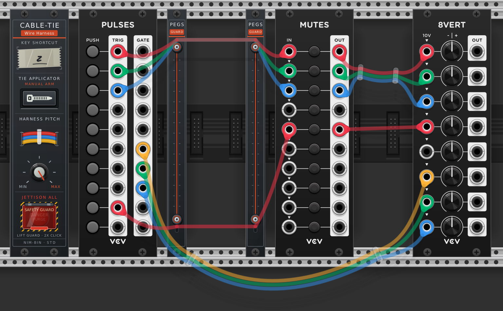

# VCV Rack Cable Ties (Wiring Harness Manager)

A VCV Rack v2 utility module that modifies cable behavior, enabling users to bundle patch cables together using interactive **Cable Ties**, mimicking real-world wiring harnesses and cable looms.



## Features

- **Interactive Slicing / Tie Tool**:
  - Hold a configurable shortcut key (default: `C`) and drag across any bundle of cables to slice through them.
  - An electric blue cutting line appears with real-time cable intersection detection and glowing wire highlights.
  - A live tooltip displays the number of captured wires (e.g., `Tie 3 wires`, `Tie 6 wires`).
  - Releasing the mouse button secures the cables into a parallel bundle with a nylon cable tie!
- **Real-World Wiring Harness Topologies**:
  - Support for multiple cable ties along any cable path.
  - Realistic breakouts and branching: bundle 6 wires from module A through a tie, split 4 wires to a second tie heading to module B, and branch 2 wires off towards module C.
  - Parallel ribbon offsets through each cable tie to maintain clean wire order and prevent visual tangling.
  - Smooth $C^1$ cubic Bezier spline interpolation with physical gravity sag that respects VCV Rack's cable tension setting.
- **Conflict-Free Pan & Interaction**:
  - Normal rack navigation (middle-click pan, Alt-click pan, right-click pan, box select, and port patching) is 100% unaffected when the shortcut is not held.
  - Dedicated **ARM TOOL** front-panel lighted button and context menu option allows toggling Tie Mode ON without holding any keyboard shortcut.
- **User-Settable Shortcuts & Custom Key-Combo Binding**:
  - Configured directly in the module's right-click context menu.
  - Click **Bind Custom Key / Combo...** and press any key or key combination (e.g., `C`, `Shift+C`, `Ctrl+Shift+T`, or modifier-only like `Shift` or `Ctrl+Shift`).
  - Also includes a **Preset Shortcuts** submenu for quick selection.
- **Interactive Cable Tie Manipulation**:
  - **Move**: Click and drag any cable tie to reposition it in real-time; connected cables dynamically re-route smoothly.
  - **Snip / Remove**: Right-click any cable tie to remove it, releasing the cables.
  - **Snip All**: Front-panel button and context menu action to clear all cable ties at once.
- **Customizable Appearance**:
  - **Wire Spacing Knob**: Adjust bundle ribbon spacing (2.0 px to 6.0 px) with a live 3-wire harness preview.
  - **Tie Styles**: Translucent Nylon (Default) and Black.
  - **Light & Dark NIM-BIN Panels**: Automatically adapts to VCV Rack's global *"Use dark panels if available"* option.
- **2HP Cable Pegs (`CablePegs`) Keep-Out Module**:
  - **Automatic Wire & Bundle Deflection**: A 2HP companion module with top and bottom turret pegs that deflect any individual cable or cable-tied wire bundle that would cross between the pegs.
  - **Horizontal Keep-Out Linking**: Place two **Cable Pegs** modules on either side of a module with a screen or analyzer, right-click one, and choose **Link to Left Peg Module** or **Link to Right Peg Module** to form a 2D keep-out zone over the protected module.
  - **Multi-Row Vertical Linking**: When two **Cable Pegs** modules are aligned vertically on adjacent rack rows, a **LINK** button appears on the panel; linking them visually removes the inner shared pegs (bottom peg of top module, top peg of bottom module) to create a continuous multi-row keep-out barrier.
  - **Un-routable Fallback**: If an area is completely un-routable due to peg placement, cables safely ignore the blocking pegs and route straight through.
- **Full Patch Persistence**:
  - All cable ties, positions, and harness topologies are serialized into patch JSON (`dataToJson` / `dataFromJson`).
  - Automatic cleanup when cables or modules are deleted or disconnected.

## Building

Requires the [VCV Rack SDK](https://vcvrack.com/manual/PluginDevelopmentTutorial) with `RACK_DIR` set in your environment.

```bash
make
make dist
make install
```
